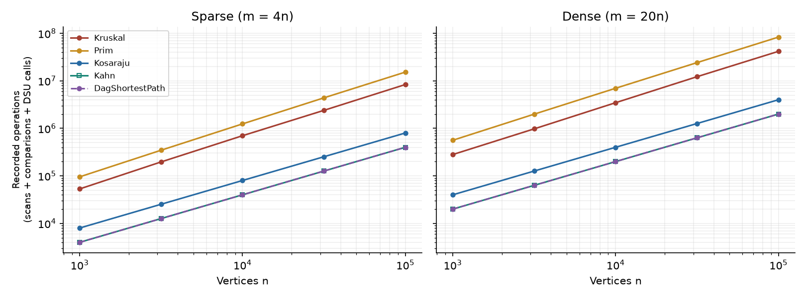
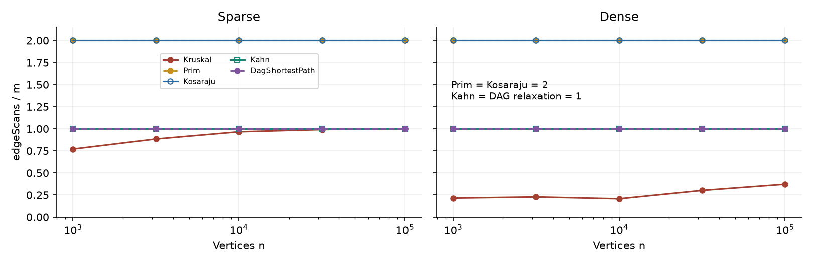
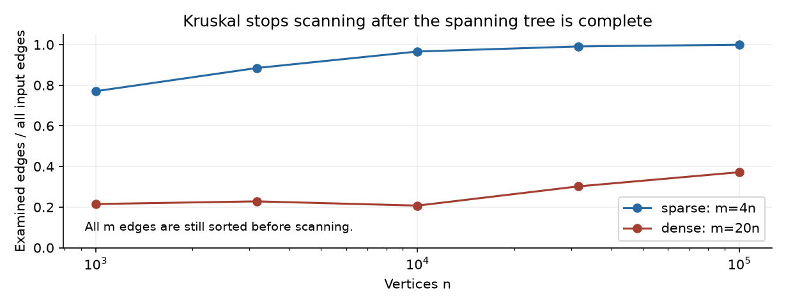

# Assignment 3: City Network & Job Scheduler

**Beibarys Balykbayev | SE-2516**  
Design and Analysis of Algorithms | 21 October 2026

## 1. Design, methodology, and complexity

One adjacency-list Graph supports directed and undirected inputs, integer weights, loops, parallel edges, isolated vertices, and empty graphs. Primitive arrays store adjacency arcs and input-edge IDs. Both MST implementations return a forest and its component count. Sums and distances use long. DSU uses union by size and iterative full path compression; SCC traversals use explicit stacks, never recursive DFS.

Each of five sizes (1,000; 3,162; 10,000; 31,623; 100,000) has sparse E=4V and dense E=20V cases. Three graph kinds use independent, fresh Random(42) instances per case and the exact prescribed random-call order. The benchmark performs one warmup and five measured repetitions, reports median milliseconds, and fails on numerical disagreement. All ten MST weights, SCC counts, and DAG sums match the handout: 30/30 reference checks. The main CSV has 50 rows; the bonus CSV has ten Tarjan rows.

| Algorithm | Time | Extra space | Justification |
| --- | --- | --- | --- |
| DSU makeSet | O(V) | O(V) | Initialize parent and size arrays. |
| DSU find / union | O(alpha(V)) amortized | O(1) per call | Compression and size balancing; backing arrays use O(V). |
| Kruskal | O(V + E log(E+1) + E alpha(V)) | O(V+E) | Merge-sort all edges, then at most E unions; V-array initialization. |
| Prim, lazy heap | O(V + E log(E+1)) | O(V+E) | At most O(E) frontier entries and heap removals; inspect adjacency arcs. |
| Kosaraju | O(V+E) | O(V+E) | Two DFS passes and a stored transpose; arrays and stacks are O(V). |
| Kahn | O(V+E) | O(V) | Each vertex queued once; each directed edge decrements one in-degree. |
| DAG shortest paths | O(V+E) | O(V) | Kahn plus one topological relaxation pass and parent/distance arrays. |
| Tarjan (bonus) | O(V+E) | O(V) | One DFS, lowlink/index arrays, DFS and active stacks. |

Extra space excludes the input graph and includes results. The lazy Prim implementation uses an edge heap, so O(E log E), rather than the O(E log V) bound for an indexed vertex heap, is the precise unrestricted-multigraph description. In the benchmark E=cV, the two logarithmic forms have the same asymptotic class. DSU's amortized bound is for operation sequences; one call can take O(log V).

Counter scopes are explicit: edgeScans counts algorithmic traversal/selection, comparisons counts only weight comparisons in sorting/heaps, and dsuOps counts public find calls plus successful unions. Transpose construction is timed but excluded from DFS scans. DAG timing includes Kahn; its reported scans count only relaxations. maxDepth measures occupied explicit stacks; Tarjan takes the maximum over both stacks. These choices produce the required 2E Kosaraju and E Kahn/DAG counters without fabricating counts from formulas.

<!-- PAGEBREAK -->

## 2. Measured counters and growth

The following ratios use all five sizes in order. Complete values are in results/ratios.csv. Ratios with E log2 E use actual weight comparisons; ratios with V+E use traversal scans.

| Algorithm and normalized counter | Sparse, E=4V | Dense, E=20V |
| --- | --- | --- |
| Kruskal: comparisons / (E log2 E), range | 0.8961 to 0.9491 | 0.9221 to 0.9532 |
| Kruskal: dsuOps / E, first to last | 1.7908 to 2.2483 | 0.4802 to 0.7936 |
| Prim: comparisons / (E log2 E), first to last | 1.8270 to 1.9458 | 1.8262 to 1.8921 |
| Prim: scans / (V+E), every size | 1.6000 | 1.9048 |
| Kosaraju: scans / (V+E), every size | 1.6000 | 1.9048 |
| Kahn: scans / (V+E), every size | 0.8000 | 0.9524 |
| DAG relaxation: scans / (V+E), every size | 0.8000 | 0.9524 |

Traversal ratios are exactly constant for each density. Sorting/heap comparison ratios stay within narrow bands, consistent with E log E work. Kruskal's DSU ratio changes because the stopping point changes: the algorithm ends when a spanning tree is complete. With S examined edges, dsuOps=2S+(V-1) on these connected graphs. Hence dsuOps/E is bounded by 2+(V-1)/E, but need not be constant over five random cases. Counting calls confirms call frequency, not the internal alpha(V) cost. Empirical consistency supports the complexity analysis; finite samples do not prove an asymptotic bound.

Ordinary least squares fits log10(counter) against log10(V), separately by density. Since E=cV, these slopes also describe growth with E.

| Algorithm | Scan slope, sparse / dense | Comparison slope, sparse / dense |
| --- | --- | --- |
| Kruskal | 1.0550 / 1.1194 | 1.1055 / 1.0868 |
| Prim | 1.0000 / 1.0000 | 1.1095 / 1.0904 |
| Kosaraju | 1.0000 / 1.0000 | Not applicable |
| Kahn | 1.0000 / 1.0000 | Not applicable |
| DAG relaxation | 1.0000 / 1.0000 | Not applicable |

The handout associates Kruskal's scan slope with its sorting logarithm. Those are different operations: sorting comparisons reveal the log factor; selection scans are at most E and may stop early. The measured scan slopes above 1 reflect the changing examined fraction over this finite range, not an E log E scan bound. The comparison slopes are the appropriate evidence for sorting work.

At V=100,000 and E=2,000,000, both MSTs weigh 3,056,681, Kosaraju finds one SCC, and DAG distances sum to 23,512,087. Kruskal examines 743,572 edges (37.18%) but sorts all 2,000,000; its 39,423,544 weight comparisons contrast with Prim's 79,207,333. These counters favor this Kruskal implementation on these generated inputs without claiming it always wins.

<!-- PAGEBREAK -->

## 3. Three reproducible plots

Operations sum scans, weight comparisons, and DSU calls; they exclude vertex initialization and other uncounted instructions. Kahn and DAG relaxation overlap. Linear traversals have slope 1; sorting/heaps grow slightly faster.

Prim and Kosaraju overlap at 2; Kahn and DAG relaxation overlap at 1. Prim visits both arcs of every undirected edge, while Kosaraju visits each directed edge in each DFS pass.

Kruskal examines 77.05% to 99.917% of sparse inputs, and 20.736% to 37.179% of dense inputs over these five sizes. A smaller selected-scan fraction saves DSU work, while sorting still processes every edge. Scripts/analyze.py builds all charts and slope/ratio files directly from the CSV.

<!-- PAGEBREAK -->

## 4. Correctness and algorithm selection

**Cut property (seven sentences).** Consider a forest F that is contained in some minimum spanning forest T. Let a cut respect F, meaning no edge of F crosses it, and let e be a minimum-weight edge crossing that cut. If T contains e, adding e to F preserves the invariant. Otherwise, adding e to T creates a cycle inside the relevant connected component. That cycle contains another crossing edge f, and w(e) <= w(f), so replacing f by e yields a spanning forest of no greater weight containing F and e. Kruskal applies this argument to the cut around a DSU component: an earlier, lighter crossing edge could not already have been rejected unless its endpoints were already connected. Prim applies it to the cut between the visited part of the current component and its unvisited vertices; stale heap entries are skipped, and restarting on an unvisited root extends the argument to disconnected graphs.

**DAG relaxation induction (seven sentences).** Every nonempty finite DAG has a zero-in-degree vertex, and following predecessors backwards from any vertex eventually reaches such a source. Initializing all sources to distance zero is therefore equivalent to attaching a virtual super-source with zero-weight outgoing edges. Assume that, before a vertex v is processed in topological order, every earlier vertex has its correct shortest distance. All predecessors of v are earlier, so every possible last edge into v has already been relaxed from its correct predecessor distance. Taking the minimum of these candidates gives the correct distance to v, establishing the inductive step. Relaxing v's outgoing edges then prepares later vertices, and each stored parent identifies the predecessor that attained the current minimum. Negative weights do not invalidate this argument because a DAG has no cycle; in a general graph topological order may not exist and a reachable negative cycle can make shortest-walk distances unbounded, although Bellman–Ford still handles general graphs without such cycles.

Kosaraju's first pass orders SCCs by decreasing finish time; on the transpose, the next unassigned root cannot reach an unprocessed different SCC, so each second-pass tree is exactly one SCC. Kahn queues only vertices whose remaining predecessors are exhausted. If it removes fewer than V vertices, the remaining subgraph contains a cycle; no partial order is returned as a complete answer.

| Situation | Choice | Reason |
| --- | --- | --- |
| Undirected graph already an edge list, sparse or presorted | Kruskal + DSU | Direct edge sorting/filtering; no adjacency-frontier machinery needed. |
| Undirected adjacency list, sparse network | Prim or Kruskal | Prim grows locally; compare heap work against sorting and data conversion. |
| Dense simple graph already in a matrix | Array Prim, O(V squared) | Avoid logarithmic heap/sort work; this is an alternative, not our lazy heap implementation. |
| Disconnected undirected network | Either MST implementation | Restart Prim or let Kruskal finish all edges; return a forest. |
| Directed graph may have cycles/deadlocks | Kosaraju or Tarjan | Find SCCs; a multi-vertex SCC or a self-loop signals a dependency cycle. |
| Need dependency order or cycle rejection | Kahn | O(V+E), with explicit failure if the order is incomplete. |
| Shortest paths, DAG with negative edges | Topological relaxation | O(V+E); works from every source and restores paths. |
| Cyclic shortest-path graph | Dijkstra if nonnegative; Bellman–Ford otherwise | Topological relaxation has no applicable order. |

<!-- PAGEBREAK -->

## 5. Validation, bonuses, timing, and release

**Testing evidence.** All 19 JUnit 5 test methods passed, with zero failures, errors, or skipped tests. DSU is checked against a simple relabeling partition implementation after random unions. One hundred connected graphs compare both MST weights and n-1 edge counts, while forty tiny graphs independently enumerate all spanning trees. SCC partitions are checked against BFS reachability in both graph directions on forty-five random graphs, including n=200. One hundred random DAGs with negative edges compare every distance with Bellman–Ford and validate the weight of every restored path. Tests use all four data files, validate malformed input and duplicate/invalid topological orders, exercise loops and parallel edges, and check long arithmetic beyond int range. Both SCC algorithms process a 100,000-vertex path and its cycle-closing variant; the path records maxDepth=100,000 without StackOverflowError. Bonus longest paths are independently enumerated on fifty small random condensations.

**Bonus A: iterative Tarjan.** Each vertex receives a discovery index and lowlink; a separate stack keeps vertices whose SCC is still active. A tree-child return propagates its lowlink; an edge to an active visited vertex uses that vertex's discovery index. A completed vertex with lowlink equal to its index pops exactly one SCC. The benchmark compares the full partition with Kosaraju using a bijection between component labels, rather than comparing arbitrary numeric IDs. Tarjan scans E edges versus Kosaraju's 2E: at the largest dense input, 2,000,000 versus 4,000,000. It also avoids storing a transpose, reducing extra space from O(V+E) to O(V), although both time bounds remain O(V+E).

**Bonus B: condensation and critical path.** Replace each SCC with one vertex and discard internal edges. Any directed cycle among distinct components would make them mutually reachable and therefore one SCC, so the condensation is a DAG. Parallel component dependencies keep their maximum weight for the longest-path objective. Initialize sources at zero and replace shortest-path minimum relaxation by maximum relaxation, keeping parents to restore a critical path. This is equivalent to negating weights and minimizing, while avoiding int-negation overflow. The example cyclic input condenses to four vertices and two edges, with a critical path of length 4. This measures delays between components, not an original-graph longest path or the execution duration inside an SCC; scheduling a cyclic SCC itself first requires resolving its deadlock. With nonnegative task/dependency durations, a longest dependency chain determines minimum completion time given sufficient parallel workers; longest simple path in a general directed graph is NP-hard.

**Wall-clock observations.** Recorded medians span 1.11-326.88 ms for Kruskal, 3.89-2803.13 ms for Prim, 0.77-384.87 ms for Kosaraju, 0.17-193.37 ms for Kahn, and 0.68-416.17 ms for DAG paths. Some larger cases beat smaller ones, consistent with JIT warmup and short-run noise. JVM behavior, cache locality, garbage collection, hardware, and background load affect these values. Operation counters are reproducible evidence; times are context only. Environment.txt records the actual OpenJDK 21 runtime; source targets Java 17. DAG time includes topological sorting while its main edge counter describes the relaxation phase, so time and that single counter have different scopes.

**Release and reproducibility.** The project has main, five named feature branches, incremental commits, and tag v1.0. Run `bash scripts/reproduce.sh` after installing the Python requirements to rebuild, test, benchmark, and plot. Source and data are sufficient to reproduce all numerical results. The release ZIP includes the report, three PNGs, CSVs, a runnable JAR, test evidence, and a Git bundle preserving branches/history. The configured repository is https://github.com/lackoftalentt/assignment3daa; publication could not be verified because GitHub DNS was unavailable in the execution environment. README gives non-forcing push commands. AI assistance is acknowledged in README; the defense guide explains each decision and the measured limitations.
